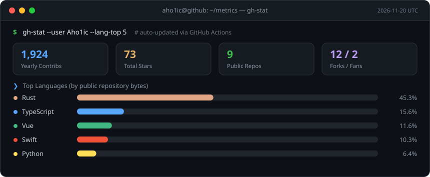
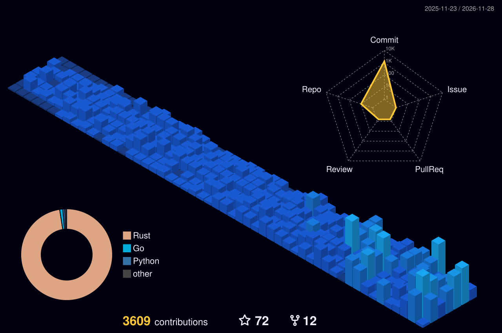

<!-- ============================== hero banner ============================== -->

  
  
  
  
  

<!-- ============================ daemon terminal ============================ -->

  

  

<!-- =========================== featured projects =========================== -->

## ❯ Featured Projects · 精选项目

<table>
  <tr>
    <td width="50%" valign="top">
      
        
      <b>原生 macOS / iOS AI Coding Agent 工作台</b>
        
      
        ﹂Rust 核心 + SwiftUI 原生客户端，零 WebView 负担 
        ﹂直连 Claude Code · Codex · omp · DeepSeek Harness 协议 
        ﹂实时工具调用、内联审批、多项目工作区与 iOS 远控推送
      
        
      
      
      
    </td>
    <td width="50%" valign="top">
      
        
      <b>轻量自托管统一邮件网关 &amp; 原生客户端</b>
        
      
        ﹂单 Go 进程聚合 QQ / 163 / Gmail / Outlook / iCloud 等 8 大邮箱 
        ﹂实时 IMAP 同步、SQLite FTS5 检索与 AES-256-GCM 凭据加密 
        ﹂内置自持域名 TempMail 临时邮箱、自动化转发与 SwiftUI / React 端
      
        
      <!-- NexusMail 正式公开后，把下方 Releasing Soon 替换为实时 Star 徽章即可：
      
      -->
      
      
      
    </td>
  </tr>
  <tr>
    <td width="50%" valign="top">
      
        
      <b>全链路 WireGuard 内网自托管多 VPS 监控系统</b>
        
      
        ﹂零公网入口，探针每 3 秒经 WebSocket 上推主机指标并三层降采样 
        ﹂多节点 ICMP / TCP / HTTP 拨测，精准区分本机出网与目标故障 
        ﹂TLS 证书防劫持变更告警、四级权限远控与 ECDSA 签名自更新
      
        
      
      
      
    </td>
    <td width="50%" valign="top">
      
        
      <b>CLIProxyAPI 协议适配插件 · OpenAI / Anthropic SSE</b>
        
      
        ﹂复用 Xiaomi MiMo 桌面端账号凭据并自动刷新 Token 
        ﹂将 MiMo 系列模型暴露为标准 OpenAI Chat 与 Anthropic Messages 
        ﹂无缝对接 Claude Code、Cursor、Cline 与各类 Agent SDK
      
        
      
      
      
    </td>
  </tr>
</table>

  

<!-- =========================== tech stack ================================== -->

## ❯ Tech Stack & Toolchain · 技术栈

  

<strong>🧰 展开完整技术栈矩阵（languages / native &amp; web / ai agents / infra）</strong>

 

<table width="100%">
  <tr>
    <td width="18%"><b>languages</b></td>
    <td>
      
      
      
      
      
    </td>
  </tr>
  <tr>
    <td><b>native &amp; web</b></td>
    <td>
      
      
      
      
      
    </td>
  </tr>
  <tr>
    <td><b>ai / agents</b></td>
    <td>
      
      
      
      
      
    </td>
  </tr>
  <tr>
    <td><b>infra &amp; data</b></td>
    <td>
      
      
      
      
      
    </td>
  </tr>
</table>

<!-- ========================== workspace & roast ============================ -->

## ❯ Workspace &amp; Roast · 装备与彩蛋

<table width="100%">
  <tr>
    <td width="48%" valign="top">
      <b>🖥️ Daily Workspace</b>
        
      
       
      
      
       
      
      
        
      主力在 macOS 上用 Xcode + Zed + AI Coding Agent 驱动全栈原生与自托管基建开发。
    </td>
    <td width="52%" valign="middle" align="center">
      <a href="https://ghfind.com/u/Aho1ic?ref=badge">
        <picture>
          <source media="(prefers-color-scheme: dark)" srcset="https://ghfind.com/api/card/mini/Aho1ic?theme=dark&lang=zh" />
          <source media="(prefers-color-scheme: light)" srcset="https://ghfind.com/api/card/mini/Aho1ic?theme=light&lang=zh" />
          
        </picture>
      </a>
    </td>
  </tr>
</table>

  

<!-- ============================ live metrics =============================== -->

## ❯ Live Metrics · 实时数据

  <!-- 由 scripts/generate_metrics.py + GitHub Actions 每日自绘更新，零第三方裂图风险 -->
  

<!-- ===================== 3d contribution city & snake ====================== -->

## ❯ 3D Contribution City &amp; Snake · 贡献地形与贪吃蛇

  <picture>
    <source media="(prefers-color-scheme: dark)" srcset="https://raw.githubusercontent.com/Aho1ic/Aho1ic/output/profile-3d-contrib/profile-night-view.svg" />
    <source media="(prefers-color-scheme: light)" srcset="https://raw.githubusercontent.com/Aho1ic/Aho1ic/output/profile-3d-contrib/profile-green.svg" />
    
  </picture>

  <picture>
    <source media="(prefers-color-scheme: dark)" srcset="https://raw.githubusercontent.com/Aho1ic/Aho1ic/output/github-contribution-grid-snake-dark.svg" />
    <source media="(prefers-color-scheme: light)" srcset="https://raw.githubusercontent.com/Aho1ic/Aho1ic/output/github-contribution-grid-snake.svg" />
    
  </picture>

  

  Crafted by <b>Aho1ic</b> in Nanjing · Powered by Custom SVGs &amp; GitHub Actions

